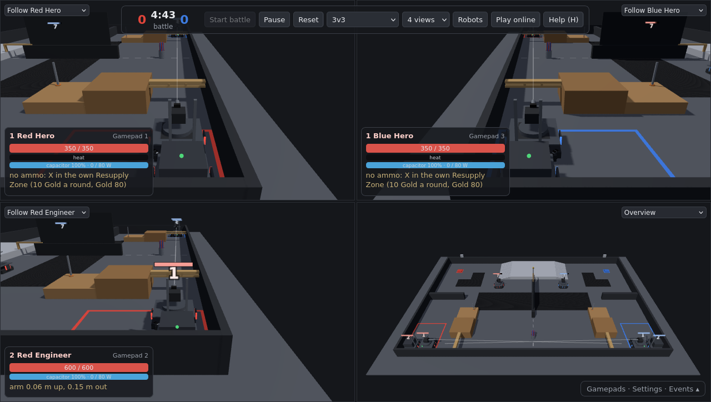

# ARCC Match Simulator (Season 2, 2026-27)

An unofficial match simulator for the **ARCC Season 2 3v3 battle**, running in the browser: Red and Blue
each field a Hero, an Engineer and a Sentry on the Season 2 battlefield, with physics, the scoring and
penalty rules, an autonomous Sentry, split-screen play with keyboards and gamepads, and online rooms
with one player per computer.

**Play:** <https://arcc-match-sim.vercel.app> · online rooms: <https://arcc-match-sim.vercel.app/?online>



It is a strategy and driver-practice tool, not a faithful robot model: robot sizes, masses and drive
numbers are estimates (see [Accuracy](#accuracy-and-limitations)). Not affiliated with or endorsed by
ARCC, RoboMaster or DJI.

## Features

- **Battlefield** from the ARCC S2 Events Manual V1.0 (2026-11-01): 12 m × 8 m, Central and Side High
  Grounds with ramps, Central Wall, Central and Side Limbo Bars, Scoring Areas, Pipe Chutes, Bumpy Road
  (visual only), Resupply Zones. Blue's half is Red's mirrored about the central line.
- **Robots:** Hero (42 mm launcher, buys rounds with Gold), Engineer (lift and reach arm, picks up
  objectives), Sentry (17 mm launcher). Powered omni chassis limited by traction and the 80 W power
  budget, with a supercapacitor boost and spin mode.
- **Objectives and rules:** cube (1 VP/s) and donuts (5 VP/s) lying flat on a Scoring Area, coloured
  pipes turned in at a Pipe Chute (30 VP to the pipe's colour), kills (20 VP); 5:00 battle, first to
  300 VP; Penalty Zones (3 s, Yellow Cards), only Engineers may control objectives, respawn and
  Weakened state, healing in the Resupply Zone, Gold, launcher heat.
- **Shooting:** auto-aim locks on to an enemy in sight within 3 m and ±60° of the view; farther away
  you aim by hand with the view (an aim line turns green on an enemy). Each robot has a hit
  probability setting; shots are not simulated as projectiles.
- **Sentry autonomy:** patrols its own half, fires at enemies within 3 m (all round), retreats to heal
  below 25 % HP or when Weakened, stops for robots in its way. Routes are planned on the field (walls,
  steps, ramps, Limbo Bars, Penalty Zones) with A*.
- **Local play:** up to four views on one screen, each with its own camera; two keyboard key sets and
  up to four gamepads.
- **Online play:** rooms with 6 player seats and 4 spectator seats. An empty Sentry seat can drive
  itself. The room creator's browser runs the simulation; the others send their controls and receive
  snapshots.
- **Practice mode:** the Red alliance alone against three fixed targets (`?mode=targets`).
- Settings for hit probabilities, aim cone and range, Sentry behaviour, and whether each Sentry may
  pass under the Limbo Bars.

## Controls

| Action | Keyboard (WASD set) | Keyboard (arrow set) | Gamepad (Xbox layout) |
|---|---|---|---|
| Move | W A S D | ↑ ← ↓ → | left stick |
| Turn (view; the chassis follows) | Q / E | , / . | right stick left / right |
| Fire (hold) · Engineer: grab / let go | Space | Enter | RT (or A) |
| Engineer arm up / down | R / F | ; / / | D-pad up / down |
| Engineer arm out / in | T / G | ] / [ | RB / LB |
| Boost (supercapacitor) | Left Shift | Right Shift | LT |
| Hero: buy 42 mm rounds (own Resupply Zone) | B | \ | X |
| Spin mode on / off | C | ' | Y |

Global: V camera (one view), H help, P pause (local only), U hide panels. Each robot card lists the
keys for its control. Browsers only show a gamepad after one of its buttons is pressed on the page;
the Gamepads panel shows which pad is which.

## Running it

There is no build step: the page is plain ES modules, and three.js and Rapier load from the jsDelivr
CDN. Serve the folder over HTTP (modules do not load from `file://`):

```bash
python3 -m http.server 8765
```

Then open <http://localhost:8765>. Address options: `?mode=targets`, `?layout=single|quad`, `?2d`
(top-down 2D view, also used automatically without WebGL), `?online`, `?room=CODE`, `?server=wss://...`.

**Self-checks:** open `?test` and see the browser console, or run `matchSim.runTests()` there. These
are headless scenarios covering driving, ramps, scoring, penalties, shooting, Sentry autonomy, the
release of held objectives, and online input handling.

## Online play

1. One person opens the page with `?online` (or clicks **Play online**), creates a room and shares
   the invite link.
2. Everyone picks a seat; a game starts 3 s after every seated player is ready.
3. In the game, players can watch the whole field or their own robot; spectators can use any view.
   **Back to room** ends the game for everyone, for example to change settings.

The room creator's browser runs the simulation, so keep that window in front during a game. Room
logic is in [`net/room_core.js`](net/room_core.js) and is shared by two servers:

- **Cloudflare Worker** ([`net/cloudflare/`](net/cloudflare)): one Durable Object per room. It works
  on any network, including campus Wi-Fi.
- **Local server** ([`net/local_server.mjs`](net/local_server.mjs), Node, no dependencies): also
  serves the page. Run `node net/local_server.mjs`, then everyone opens the printed
  `http://<address>:8787/?online`. It only works where devices can reach each other, such as a phone
  hotspot or your own router.

### Hosting your own copy

- **Page:** any static host; this repository's root is the site. With Vercel, import the repository
  as a project with the "Other" preset and no build command. `.vercelignore` keeps `net/` and `docs/`
  out of the upload.
- **Room server:** with a free Cloudflare account,

  ```bash
  npx wrangler login
  npx wrangler deploy --config net/cloudflare/wrangler.toml
  ```

  Then put the printed `wss://…workers.dev` address into `CLOUD_SERVER` in
  [`src/net_config.js`](src/net_config.js). The address committed there is the maintainer's server:
  please deploy your own for your team.
- **Free tier:** a full 6-player game sends about 120 messages a second to the room server. Cloudflare
  bills 20 incoming WebSocket messages as one request against the free 100,000 requests per day, so
  that is roughly 4–5 hours of full games per day.

## Project layout

| Path | Contents |
|---|---|
| `index.html` | page, styles, import map |
| `src/sim.js` | simulation: Rapier world, robots, chassis model, engineer arm, shooting, rules |
| `src/params.js` | every tunable value: rules, robot classes, drive model, shooting, Sentry autonomy |
| `src/sentry_auto.js`, `src/planner.js` | Sentry autonomy and the grid route planner |
| `src/render.js`, `src/render2d.js` | 3D view (three.js, split screen) and 2D fallback |
| `src/ui.js`, `src/input.js` | panels and help; keyboard and gamepad input |
| `src/lobby.js`, `src/online.js`, `src/net_client.js`, `src/net_config.js` | online rooms, snapshots and sync |
| `src/field_data.js` | battlefield parts and zones, in field coordinates (metres) |
| `src/tests.js` | self-checks |
| `net/` | room servers: shared logic, local Node server, Cloudflare Worker |

## Accuracy and limitations

- Robot dimensions, masses, power, traction and speeds are **estimates** (`GUESS` in `src/params.js`)
  until measured on real robots.
- The battlefield follows the Events Manual figures; some values are read off the drawings. The
  zig-zag pole is a straight pole until its shape is published. `src/field_data.js` was generated from
  the manual's geometry by a script in the maintainer's ROS workspace and can be edited directly.
- The Engineer picks up an objective within 0.22 m of its grab point; there is no gripper physics.
- Shots hit with the set probability, not as simulated projectiles; objectives do not block shots.
- Online, inputs travel to the host and positions come back, so expect about 0.2 s between a key
  press and seeing your own robot move.

Issues and pull requests are welcome, especially measured robot values and rule corrections.

## License

[MIT](LICENSE). Uses [three.js](https://threejs.org) (MIT) and
[Rapier](https://rapier.rs) (Apache-2.0), both loaded from the jsDelivr CDN.
